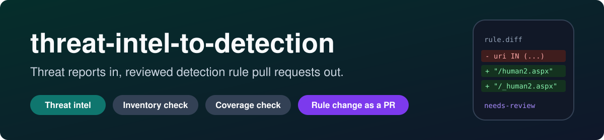
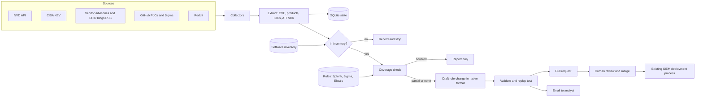

<p align="center">
  
</p>

<p align="center">
  
  
  
  
  
  
</p>

**threat-intel-to-detection** turns new threat intelligence into **reviewed detection rule changes**. It reads public sources, checks each finding against the software inventory and the existing rules, drafts the missing detection in the rule's own format (Splunk, Sigma or Elastic), and opens a pull request. A human reviews and merges. The pipeline never touches the SIEM.

The command-line tool inside the repository is called `intel-to-rule`.

> [!NOTE]
> **Portfolio demo on sample data.** The company ("Ashgrove Manufacturing"), its inventory and its rules are fictional. The attacks in [`cases/`](cases/) are real public incidents (MOVEit Transfer, Ivanti Connect Secure, Citrix Bleed), recorded as short paraphrased fixtures with citations. The live collectors are implemented, but the scheduled job is switched off.

## At a glance

| | |
|---|---|
| **Problem** | After every new advisory a detection engineer asks by hand: do we run this, do our rules already catch it, and what should change? That takes hours or days while attackers already exploit the flaw. |
| **Approach** | Inventory match, then a coverage check against every existing rule and log source, then the smallest possible edit to the closest rule. |
| **Output** | A pull request and an analyst email with the reason, the affected assets, the rule diff, replay test results, false positive notes and sources. |
| **Safety** | Nothing reaches production without review. LLM output, blogs and Reddit are treated as untrusted input. |
| **Proof** | Three worked cases with before and after rules, 28 unit and end-to-end tests, CI that validates every rule. |

## Example: the rule change it proposes for MOVEit

Ashgrove had a generic web shell rule and a "script dropped in the IIS web root" rule. Neither caught MOVEit, because the web shell was named `human2.aspx` and MOVEit does not live under `inetpub`. The pipeline extended both rules in their own formats instead of writing new ones:

```diff
--- a/rules/splunk/web_generic_webshell_requests.yml
+++ b/rules/splunk/web_generic_webshell_requests.yml
-version: 3
+version: 4
-  ... where Web.url IN ("*/cmd.aspx*", "*/shell.aspx*", "*/c99.php*", "*/r57.php*", "*/b374k.php*", "*/wso.php*") ...
+  ... where Web.url IN ("*/cmd.aspx*", "*/shell.aspx*", "*/c99.php*", "*/r57.php*", "*/b374k.php*", "*/wso.php*", "*/human2.aspx*", "*/_human2.aspx*") ...
-cve: []
+cve:
+  - CVE-2023-34362

--- a/rules/sigma/file_event_win_script_in_iis_webroot.yml
+++ b/rules/sigma/file_event_win_script_in_iis_webroot.yml
     TargetFilename|contains:
       - '\inetpub\wwwroot\'
+      - '\MOVEit Transfer\wwwroot\'
+      - '\MOVEitTransfer\wwwroot\'
```

Then it replayed a synthetic attack event: the old Sigma rule stayed silent, the new one fired, and a benign file in the same folder did not fire. Full diff, email and the "what still needs a human" notes: [cases/01-moveit-transfer](cases/01-moveit-transfer/).

## Try it in one minute

Needs Python 3.11+. No API keys, no network.

```bash
pip install -e ".[sigma]"        # pySigma is only needed for Sigma conversion
python -m intel_to_rule validate
python -m intel_to_rule run --fixtures
python -m unittest discover -s tests -t .
```

Expected result: three rule proposals and two "not relevant" findings.

```text
CVE-2023-4966          Not covered, rule change proposed
    new       rules/splunk/cve_2023_4966_uri_long_host.yml
CVE-2023-46805         Not covered, rule change proposed
    update    rules/splunk/web_vpn_known_exploit_paths.yml
CVE-2023-34362         Not covered, rule change proposed
    update    rules/splunk/web_generic_webshell_requests.yml
    update    rules/sigma/file_event_win_script_in_iis_webroot.yml
    generated rules/generated/splunk/file_event_win_script_in_iis_webroot.spl
    generated rules/generated/elastic/file_event_win_script_in_iis_webroot.lucene
CVE-2020-14883         Not relevant to our inventory
CVE-2020-29583         Not relevant to our inventory
```

Output goes to `out/`: for each finding an `email.md`, a `pr_body.md`, one `.diff` per changed file and `finding.json`, plus `out/summary.md`.

<details>
<summary><b>Live mode</b> (real sources, optional keys)</summary>

```bash
python -m intel_to_rule run --since 7                          # collect from NVD, KEV, RSS feeds, Reddit
python -m intel_to_rule analyze https://example.com/advisory   # analyse specific pages
python -m intel_to_rule run --since 7 --llm                    # use an LLM for text extraction
python -m intel_to_rule run --fixtures --open-pr               # apply files, commit, push, open the PR with git and gh
```

| Variable | Purpose |
|---|---|
| `NVD_API_KEY` | Optional. 50 NVD requests per 30 s instead of 5 |
| `ANTHROPIC_API_KEY` | Needed for `--llm` (install `.[llm]`) |
| `SMTP_HOST`, `SMTP_PORT`, `SMTP_USER`, `SMTP_PASSWORD` | Needed for `--send-email` |

The daily GitHub Actions job ([scheduled-run.yml](.github/workflows/scheduled-run.yml)) is manual-only while the project runs on sample data.

</details>

## How it works



Everything left of "Pull request" is automatic. Everything right of it is a person.

1. **Relevance.** Matches the product and version to the inventory.
2. **Coverage.** Compares the indicators (URLs, paths, files, command lines) with every existing rule and returns `covered`, `partial`, `none` or `no_iocs`. It also checks that the SIEM actually collects the log source needed to see the attack on the affected asset.
3. **Rule change.** Extends the closest existing rule **in its own format** with the smallest possible diff. If no rule can be extended, it writes a new rule in the primary format.
4. **Report.** Writes an analyst email and a pull request with the same content.

### Rule formats in and out

Real teams do not all use Sigma. The pipeline edits each rule in the format it is stored in.

| Stored as | How the pipeline edits it | Notes |
|---|---|---|
| Splunk detection (YAML with a `search` field, Splunk Security Content layout) | Adds values to the `field IN (...)` list inside the SPL | Splunk-only teams can delete the other rule folders |
| Sigma | Adds values to the matching list in `detection`, then converts to SPL and Lucene with pySigma | Generated queries go to `rules/generated/` |
| Elastic detection (JSON, as exported from Kibana) | Adds values to the EQL/KQL list in `query` | |

Edits are text edits, so comments and ordering stay and the diff shows only what changed. When no list can be extended (for example a condition on Host header length for Citrix Bleed), the pipeline writes a new rule in `rules.primary_format`.

## Worked cases

| Case | CVE | What was missing | What the pipeline proposed |
|---|---|---|---|
| [MOVEit Transfer](cases/01-moveit-transfer/) | CVE-2023-34362 | Web shell name and MOVEit web root not in any rule | Extended one Splunk and one Sigma rule |
| [Ivanti Connect Secure](cases/02-ivanti-connect-secure/) | CVE-2023-46805, CVE-2024-21887 | Exploit URI paths not in the VPN rule | Extended the Splunk VPN exploit path rule |
| [Citrix Bleed](cases/03-citrix-bleed/) | CVE-2023-4966 | No rule could express "oversized Host header" | Wrote a new Splunk rule |

In all three, exploitation started between four days and about six weeks before the vendor advisory.

## Why a pull request and not a direct SIEM change

- **A wrong rule is expensive both ways.** Too broad and the SOC drowns in alerts. Too narrow and it gives false confidence. A person who knows the environment must decide.
- **Sources can be wrong or hostile.** An attacker could publish content built to make a rule that suppresses alerts or floods the queue. Review stops that.
- **A PR keeps history.** Every change has an author, a reason, sources and a diff. Rollback is a revert.
- **CI can test it.** Validation, replay and conversion run before merge.
- **LLM output is not trusted.** The model drafts. Parsing, validation and replay checks decide what reaches a reviewer.

## Skills this project shows

- **Detection engineering:** Splunk SPL, Sigma and Elastic rules, detection-as-code, coverage gap analysis, log source awareness.
- **Threat intelligence:** extracting CVEs, indicators and ATT&CK techniques from advisories and DFIR reports, CISA KEV, NVD.
- **Incident knowledge:** three real attack chains reconstructed from vendor and Mandiant/Volexity reports.
- **Python engineering:** pluggable rule format adapters, minimal text diffs, a small Sigma evaluator for replay tests, SQLite state, unit and end-to-end tests, GitHub Actions.
- **Safe automation:** human-in-the-loop by design, untrusted input handling, optional LLM step with deterministic checks.

## Limitations

- **Indicator matching is a heuristic.** Coverage compares literal strings. A rule with a regex or a different field name for the same thing is not recognised.
- **Behavioural and correlation detections are out of scope.** "Same session from two IPs" needs correlation searches that the pipeline does not write.
- **Field names and indexes are generic.** Generated SPL uses `index=sysmon`, `index=proxy` and the Web data model. Converted Sigma needs your own pySigma field mapping.
- **Replay tests run only for Sigma.** Splunk and Elastic changes are validated structurally, not executed.
- **Extraction quality depends on the source.** The offline demo uses recorded extractions. The LLM path (`--llm`) is implemented but not covered by tests, because it needs an API key.
- **Version matching is simple.** Vendor schemes such as `22.3R1` are reduced to their digits.

## Configuration

- `config/pipeline.yaml` sets rule folders, the primary format for new rules, email, PR labels and sources.
- `data/inventory/software_inventory.yaml` lists products, versions, aliases, exposure and **which log sources reach the SIEM for each asset**, so the pipeline can warn when a rule could never fire.

## Repository layout

```
config/            pipeline and source settings
data/inventory/    fictional software inventory
data/fixtures/     recorded reports and a KEV excerpt for the offline demo
rules/             splunk, sigma, elastic source rules and rules/generated (SPL and Lucene from Sigma)
src/intel_to_rule/ collectors, extraction, relevance, coverage, rule format adapters, generation, reports, PR, CLI
cases/             three worked cases with before/after rules, diff and example email
tests/             unit tests and an end-to-end test on the fixtures
docs/              references and image assets
RUNBOOK.md         step by step procedure for working on a new finding
```

## References and credits

Dependencies, related projects, data sources and the case study sources are listed in [docs/SOURCES.md](docs/SOURCES.md). No code was copied from other projects. Report texts in `data/fixtures/` are short paraphrases of the cited sources.

## License

MIT, see [LICENSE](LICENSE).
