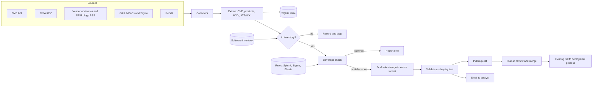

# intel-to-rule

Turns new threat intelligence into **reviewed detection rule changes**. It watches public sources, checks each finding
against your software inventory and existing rules, drafts the missing detection, and opens a pull request. A human
reviews and merges. The SIEM is never changed by the pipeline.

This is a portfolio project. The company ("Northwind Logistics"), its inventory and its rules are fictional. The attacks
in `cases/` are real public incidents (MOVEit Transfer, Ivanti Connect Secure, Citrix Bleed) and are cited.

## The problem

When a new vulnerability or attack is published, a detection engineer has to answer the same questions by hand:

1. Do we run this software?
2. Do our existing rules already catch it?
3. If not, which rule should change, and how?

Reading advisories, matching them to an inventory, searching hundreds of rules and rewriting queries for Splunk or
Elastic takes hours or days. Meanwhile the exploitation window is open. In the three cases in this repo, exploitation
started between four days and about six weeks before the vendor advisory (see the case READMEs).

## The solution

For every finding the pipeline does four things:

1. **Relevance.** Matches the product and version to the inventory.
2. **Coverage.** Compares the indicators (URLs, paths, files, command lines) with every existing rule and returns
   `covered`, `partial`, `none` or `no_iocs`. It also checks that the log source needed to see the attack is actually
   collected for the affected asset.
3. **Rule change.** Extends the closest existing rule **in its own format** (Splunk SPL, Sigma or Elastic) with the
   smallest possible diff. If no rule can be extended, it writes a new rule in your primary format.
4. **Report.** Writes an email for the analyst (what, why it matters to you, rule affected, diff, replay result, false
   positives, sources) and a pull request with the same content.

## Architecture



Everything left of "Pull request" is automatic. Everything right of it is a person.

### Rule formats in and out

Real teams do not all use Sigma. The pipeline edits rules in the format they are stored in.

| Stored as | How the pipeline edits it | Notes |
|---|---|---|
| Splunk detection (YAML with a `search` field, Splunk Security Content layout) | Adds values to the `field IN (...)` list inside the SPL | Splunk-only teams can delete the other rule folders |
| Sigma | Adds values to the matching list in `detection`, then converts to SPL and Lucene with pySigma | Generated queries go to `rules/generated/` |
| Elastic detection (JSON, as exported from Kibana) | Adds values to the EQL/KQL list in `query` | |

Edits are text edits, so comments and ordering stay and the diff shows only what changed. When no list can be
extended (for example a condition on Host header length), the pipeline writes a new rule in `rules.primary_format`.

## Quick start (offline demo)

Needs Python 3.11+. No API keys, no network.

```bash
pip install -e ".[sigma]"        # pySigma is only needed for Sigma conversion
python -m intel_to_rule validate
python -m intel_to_rule run --fixtures
python -m unittest discover -s tests -t .
```

Output goes to `out/`. For each finding there is `email.md`, `pr_body.md`, one `.diff` per changed file and
`finding.json`. `out/summary.md` lists all verdicts.

The demo reads recorded reports for three real attacks plus two unrelated KEV entries. The expected result is three
rule proposals and two "not relevant" findings.

### Live mode

```bash
python -m intel_to_rule run --since 7              # collect from NVD, KEV, RSS feeds, Reddit
python -m intel_to_rule analyze https://example.com/advisory   # analyse specific pages
python -m intel_to_rule run --since 7 --llm        # use an LLM for text extraction
```

| Variable | Purpose |
|---|---|
| `NVD_API_KEY` | Optional. 50 NVD requests per 30 s instead of 5 |
| `ANTHROPIC_API_KEY` | Needed for `--llm` (install `.[llm]`) |
| `SMTP_HOST`, `SMTP_PORT`, `SMTP_USER`, `SMTP_PASSWORD` | Needed for `--send-email` |

Pull requests use the `git` and `gh` CLIs you are already logged in with:

```bash
python -m intel_to_rule run --fixtures --open-pr      # applies the files, commits, pushes, opens the PR
```

## Configuration

- `config/pipeline.yaml` sets rule folders, the primary format for new rules, email, PR labels and sources.
- `data/inventory/software_inventory.yaml` lists products, versions, aliases, exposure and **which log sources reach
  the SIEM for each asset**. That last field lets the pipeline warn when a rule could never fire.

## Why changes go through a pull request, not straight into the SIEM

- **A wrong rule is expensive both ways.** Too broad and the SOC drowns in alerts. Too narrow and it gives false
  confidence. A person who knows the environment must decide.
- **Sources can be wrong or hostile.** The pipeline reads blogs, Reddit and GitHub. An attacker could publish content
  built to make a rule that suppresses alerts or floods the queue. A review step stops that.
- **A PR keeps history.** Every change has an author, a reason, sources and a diff. Rollback is a revert.
- **CI can test it.** Validation, replay and conversion run before merge.
- **It fits existing practice.** Teams that use detection-as-code already review rule changes this way.
- **LLM output is not trusted.** The model drafts. Parsing, validation and replay checks decide what reaches a reviewer.

## Limitations

Read these before relying on it.

- **Indicator matching is a heuristic.** Coverage compares literal strings. A rule with a regex or a different field
  name for the same thing is not recognised. The 70% overlap threshold avoids "`.aspx` covers `human2.aspx`" but is
  not proof of coverage.
- **Behavioural and correlation detections are out of scope for now.** The pipeline handles list-style indicators and
  one conditional indicator (Host header length). "Same session from two IPs" needs correlation searches that it
  does not write.
- **Field names and indexes are generic.** Generated SPL uses `index=sysmon`, `index=proxy` and the Web data model.
  Converted Sigma needs your own pySigma pipeline for field mapping.
- **Replay tests run only for Sigma** (with a small built-in evaluator for the subset the pipeline generates).
  Splunk and Elastic changes are validated structurally, not executed. Test them on sample data.
- **Extraction quality depends on the source.** The offline demo uses recorded extractions. The regex fallback finds
  only CVE IDs, ATT&CK IDs, inventory product names and a few URL patterns. The LLM path (`--llm`) is implemented but
  not exercised by the tests, because it needs an API key.
- **Version matching is simple.** Version ranges are compared as number tuples. Vendor-specific schemes (for example
  `22.3R1`) are reduced to their digits.
- **No de-duplication of equivalent new rules** across runs beyond the per-CVE state in SQLite.
- **Fictional data.** There is no real company data, and the "before" rules are examples, not real rules.

## Repository layout

```
config/            pipeline and source settings
data/inventory/    fictional software inventory
data/fixtures/     recorded reports and a KEV excerpt for the offline demo
rules/             splunk, sigma, elastic source rules and rules/generated (SPL and Lucene from Sigma)
src/intel_to_rule/ collectors, extraction, relevance, coverage, rule format adapters, generation, reports, PR, CLI
cases/             three worked cases with before/after rules, diff and example email
tests/             unit tests and an end-to-end test on the fixtures
RUNBOOK.md         step by step procedure for working on a new finding
```

## References and credits

No code was copied from the projects below. They were read for ideas, formats and facts, and the pipeline depends on
the libraries marked as dependencies.

**Dependencies**

- [pySigma](https://github.com/SigmaHQ/pySigma), [pySigma-backend-splunk](https://github.com/SigmaHQ/pySigma-backend-splunk)
  and [pySigma-backend-elasticsearch](https://github.com/SigmaHQ/pySigma-backend-elasticsearch) convert Sigma to SPL and Lucene.
- [PyYAML](https://github.com/yaml/pyyaml) parses rules and config.

**Related projects and formats**

- [christina23/kitsune](https://github.com/christina23/kitsune) starts from one threat report URL and generates Sigma
  rules for gaps in a baseline corpus. This project differs by monitoring feeds, filtering by an asset inventory,
  checking log source availability and editing rules in their native format.
- [SigmaHQ/sigma](https://github.com/SigmaHQ/sigma) defines the Sigma format. The public rules for MOVEit and Citrix
  Bleed served as references for the case studies.
- [splunk/security_content](https://github.com/splunk/security_content) is the model for the Splunk detection YAML
  layout and the source of the public Ivanti Connect Secure detection the Ivanti case compares against.
- [edwardjgriggs/detection-as-code](https://github.com/edwardjgriggs/detection-as-code) and
  [infosecB/detection-as-code](https://github.com/infosecB/detection-as-code) are examples of validating and
  converting Sigma rules in CI.

**Data sources**

- [CISA Known Exploited Vulnerabilities](https://www.cisa.gov/known-exploited-vulnerabilities-catalog) (public domain),
  schema in [cisagov/kev-data](https://github.com/cisagov/kev-data).
- [NVD API 2.0](https://nvd.nist.gov/developers/start-here). This product uses data from the NVD API but is not
  endorsed or certified by the NVD.

**Case study sources**

- MOVEit: [Mandiant](https://cloud.google.com/blog/topics/threat-intelligence/zero-day-moveit-data-theft),
  [Progress advisory](https://community.progress.com/s/article/MOVEit-Transfer-Critical-Vulnerability-31May2023).
- Ivanti Connect Secure: [Volexity](https://www.volexity.com/blog/2024/01/10/active-exploitation-of-two-zero-day-vulnerabilities-in-ivanti-connect-secure-vpn/),
  [Splunk detection](https://research.splunk.com/web/1f32a7e0-a060-4545-b7de-73fcf9ad536e/).
- Citrix Bleed: [Mandiant](https://cloud.google.com/blog/topics/threat-intelligence/session-hijacking-citrix-cve-2023-4966),
  [Assetnote](https://www.assetnote.io/resources/research/citrix-bleed-leaking-session-tokens-with-cve-2023-4966),
  [Citrix bulletin](https://support.citrix.com/article/CTX579459/netscaler-adc-and-netscaler-gateway-security-bulletin-for-cve20234966-and-cve20234967).

Report texts in `data/fixtures/` are short paraphrases of these sources, not copies.

## License

MIT, see `LICENSE`.
